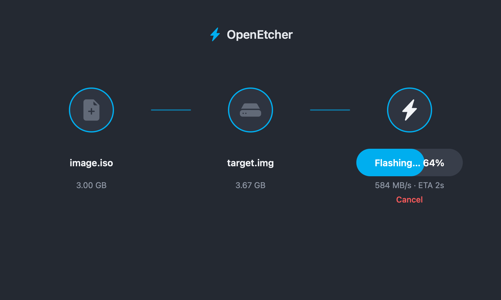
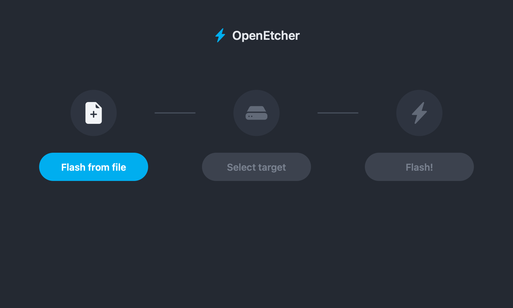
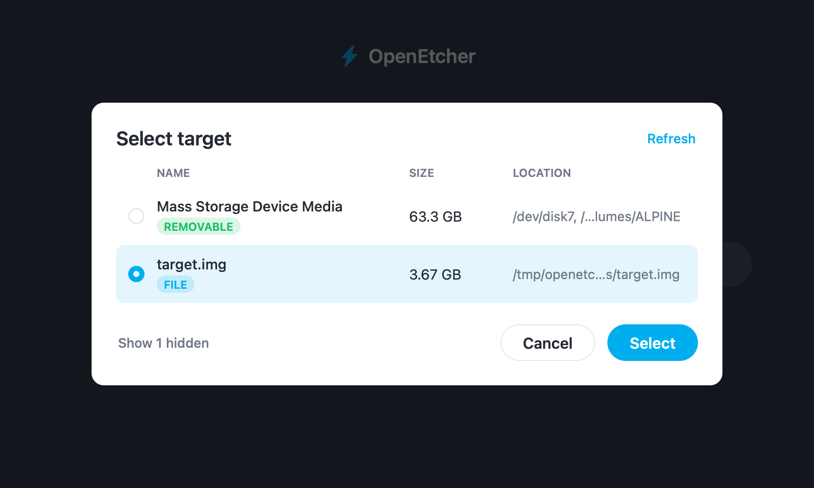
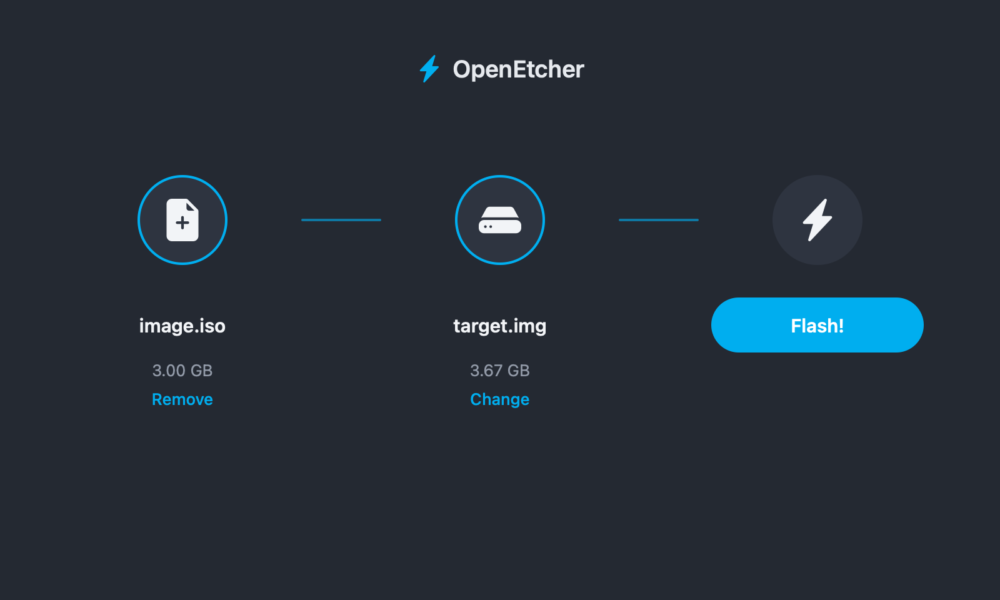
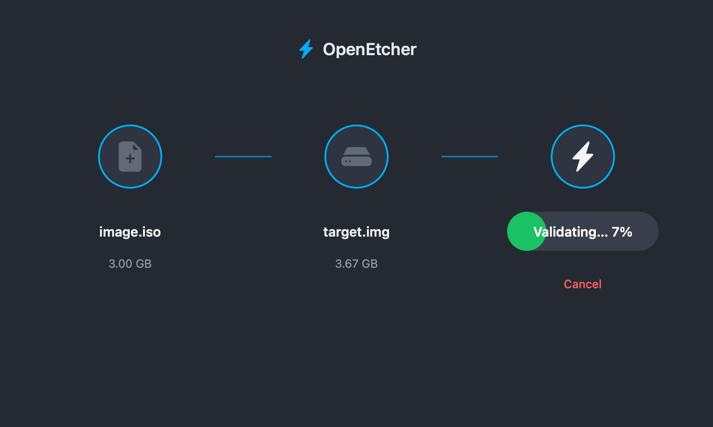
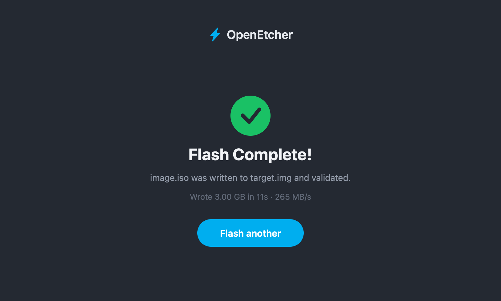

# openetcher

`openetcher` is a Zig library and command-line tool for flashing disk images. It plans writes from the image layout before writing, so supported filesystem images can skip unused regions while preserving the image's required on-disk structure.

The command-line tool is a thin layer over the `openetcher` library. Disk discovery works on macOS, Linux, and Windows; flashing physical disks works on macOS and Linux. The core planning and flashing library is platform-neutral.

On macOS it also has a GUI in the style of balena Etcher, written with the [fabrum](https://github.com/ssttevee/fabrum) UI framework (see [macOS GUI](#macos-gui)).



## Contents

- [Requirements](#requirements)
- [Build and Test](#build-and-test)
- [Command-Line Interface](#command-line-interface)
- [macOS GUI](#macos-gui)
- [Image Support and Planning](#image-support-and-planning)
- [Disk Discovery and Safety](#disk-discovery-and-safety)
- [Flashing Behavior](#flashing-behavior)
- [Library API](#library-api)
- [Architecture](#architecture)
- [Platform Support](#platform-support)
- [Limitations](#limitations)
- [License](#license)

## Requirements

- Zig `0.17.0`
- macOS or Linux for flashing physical disks; Windows for listing them
- On macOS, the DiskArbitration and CoreFoundation frameworks from the SDK, which the build links. Cross-building for another macOS architecture finds the SDK with `xcrun`

The library and command-line tool have no third-party dependencies. The macOS GUI depends on [fabrum](https://github.com/ssttevee/fabrum), which `zig build` fetches.

## Build and Test

Build the executable:

```sh
zig build
```

The executable is written to `zig-out/bin/openetcher`.

Run the test suite:

```sh
zig build test
```

Image parsers read untrusted bytes, so `src/lib/image/fuzz.zig` fuzzes the whole analyzer. It starts from a small valid image per format, patches header bytes, and fails on any panic, leak, or plan that writes outside the image. `zig build test` replays only the seed images; to search, run the fuzzer with an iteration limit:

```sh
zig build test --fuzz=100K
```

A failing input is saved under `.zig-cache/f/`, and the test prints the analysis that broke an invariant.

Zig only compiles code reachable on the target being built, so `zig build test` on one machine never compiles the other platforms' device backends or the big-endian decoding paths. Run the suite once per target, each as its own `zig build test`:

```sh
scripts/test-targets.sh                     # every default target
scripts/test-targets.sh s390x-linux-musl    # one target (s390x is big-endian)
```

macOS targets run on the host, x86_64 through Rosetta. Linux and Windows targets need Zig's qemu and Wine integration, which only works on a Linux host, so on macOS the script runs them in a Docker container built from `scripts/linux-test.Dockerfile`. Set `ZIG` to pick the host compiler.

Run the executable through the build system:

```sh
zig build run -- <command> [arguments]
```

Examples:

```sh
zig build run -- info image.img
zig build run -- disks
zig build run -- flash image.img --disk-id macos-0123456789abcdef
```

Release builds use normal Zig build options:

```sh
zig build -Doptimize=ReleaseSafe
zig build -Doptimize=ReleaseFast
```

## Command-Line Interface

```text
openetcher info [-h] [--json] [--spool-dir <dir>] <image>
openetcher plan [-h] [--json] [--spool-dir <dir>] <image>
openetcher disks [-h] [--json] [--all]
openetcher flash [-h] [--force] [--spool-dir <dir>] <image> <device>
openetcher flash [-h] [--force] [--spool-dir <dir>] <image> --disk-id <id>
```

`-h` prints byte counts in binary units such as `1.5 MiB` instead of plain numbers; JSON output always uses plain numbers. `--spool-dir` sets where compressed images are decoded; see [Compressed images](#compressed-images).

### `info`

Probes an image and prints its recognized layout, filesystem information, and partition information where applicable.

```sh
openetcher info image.img
openetcher info --json image.iso
```

The text output can include:

- `image_size`
- `compression` and `encoded_size`, the size of the image file before decoding
- `layout`
- `filesystem`
- `block_size`
- `used_bytes`
- `skipped_bytes`
- `range_count`
- MBR partition metadata and per-partition planning details

`--json` produces the same information as a JSON object. Numeric byte counts are JSON numbers.

### `plan`

Builds a flash plan without writing anything.

```sh
openetcher plan image.img
openetcher plan --json image.img
```

The output reports:

- the source image size
- planned bytes: bytes that will be read, written, and verified
- skipped bytes: image bytes omitted by sparse planning
- range count
- each byte range as an offset, length, and end offset

Planning is useful for checking whether an image format is supported and for measuring the expected sparse-write reduction before a flash.

### `disks`

Lists whole physical disk candidates.

```sh
openetcher disks
openetcher disks --json
openetcher disks --all
openetcher disks --all --json
```

By default the list holds what Etcher offers as targets: disks that are neither system disks nor virtual. `--all` adds system disks (internal fixed disks) and virtual disks (disk images, RAM disks, and on macOS the APFS containers synthesized on a physical disk).

Each entry has the fields Etcher's drivelist reports:

- `id`: disk identifier accepted by `flash --disk-id`, such as `macos-…`, `linux-…`, or `windows-…`
- `device`: device node, for example `/dev/disk4`, `/dev/sdb`, or `\\.\PhysicalDrive2`
- `raw`: node for unbuffered I/O, for example `/dev/rdisk4`; the same as `device` on Linux and Windows
- `display_name`: the drive letters of a Windows disk with volumes, otherwise `device`
- `description`: the media name, or on Linux the label, vendor, model, and mounted partitions
- `bus_type`: the transport, such as `USB`, `SATA`, `NVME`, or `Apple Fabric`
- `location`: where the disk attaches: the IOKit bus path on macOS, the `/dev/disk/by-path` link on Linux, the device interface path on Windows; absent when unknown
- `size`, `block_size` (physical sector), `logical_block_size`: bytes
- `partition_table`: `mbr` or `gpt`; absent when unknown
- `protected`: whether `flash` refuses the disk without `--force`
- `system`, `removable`, `read_only`, `virtual`
- `card`: an SD or MMC card
- `usb`, `scsi`: the attachment, as drivelist classifies it
- `raid`: a RAID set, which only Windows reports, from the adapter's bus type; never listed
- `mountpoints`: each with `path` and, when known, `label`

The `id` hashes facts that identify the disk and stay put when it is replugged into the same port or the machine reboots: the transport, the media name or vendor and model, the size, and the hardware location (the IOKit media path on macOS, the udev serial and `/dev/disk/by-path` link on Linux, the device interface path on Windows). It is more stable than a `diskN` or `sdX` name, which the OS hands out in discovery order, but it is not a hardware serial number.

### `flash`

Plans the image, prepares the target, writes planned ranges, syncs the target, and verifies written ranges by default.

Use a device path:

```sh
openetcher flash image.img /dev/disk4
```

Or use an identifier returned by `disks`:

```sh
openetcher flash image.img --disk-id macos-0123456789abcdef
```

On macOS, `/dev/diskN` is normalized to `/dev/rdiskN` for raw device I/O. The normalization is printed before flashing. If the raw device cannot be opened directly, OpenEtcher uses `/usr/libexec/authopen` to present the macOS administrator authorization dialog and receive an authorized read/write descriptor. The OpenEtcher process itself remains unprivileged.

While it works, the CLI draws progress on stderr for decoding a compressed image into its spool, writing, and verifying; `info` and `plan` show the decoding step too. Counts are in KiB. Nothing is drawn when stderr is not a terminal, so redirected output holds only the messages and the report. When `ZIG_PROGRESS` is set, as it is for a child of a Zig program that passes a progress node, progress goes to the parent process over that pipe instead, so a GUI wrapper can show it without parsing text. On success it prints:

- bytes written
- write range count
- skipped bytes
- actual throughput: planned bytes divided by flash-plus-verify elapsed time
- effective throughput: full image size divided by the same elapsed time

Target preparation is explicitly logged and excluded from throughput timing. Preparation unmounts every volume on the target disk, as Etcher's mountutils does: on macOS with a forced whole-disk unmount through DiskArbitration, including the volumes of APFS containers synthesized on the disk, and on Linux with `umount2` on each mount of the disk or its partitions, escalating from an expiring unmount to a lazy detach to a forced unmount.

## macOS GUI

On macOS, `zig build` also builds `openetcher-gui`, a window in the style of balena Etcher: choose an image, choose a target drive, flash. Run it with:

```sh
zig build gui
```

| Choose an image | Choose a target | Ready |
|---|---|---|
|  |  |  |

| Flashing | Validating | Done |
|---|---|---|
|  |  |  |

It is built on the [fabrum](https://github.com/ssttevee/fabrum) UI framework, a dependency in `build.zig.zon` that `zig build` fetches from GitHub. Its AppKit platform brings the window, the file chooser, the dialogs and the Quartz canvas. Other platforms build without it.

- The image chooser (the system's open panel) offers `.img`, `.iso`, `.raw`, `.bin`, and images compressed with gzip, xz, zstd or bzip2. A compressed image is decoded into the spool when it is chosen, with its progress shown.
- The target list comes from `listCandidateDisks` with system disks included but hidden until asked for; drives too small for the image can't be chosen. Writing to a drive asks for confirmation first, with a stronger warning for a system drive.
- While flashing, the progress bar shows the write and then the verification, with speed and time left. Cancel cancels the flash through `std.Io`, which leaves the target synced. Closing the window or quitting mid-flash asks first.
- The GUI reads progress from the library's `std.Progress` nodes in-process: it starts `std.Progress` with a pipe as its progress parent and decodes the packets itself (`src/app/progress.zig`).
- Writing to a disk needs the same rights as the CLI. Without them the flash fails with a permission error.

The interface is in `src/app/ui/` as fabrum.app components, drawn in Etcher's own look on fabrum's canvas and tested without a window by `zig build test` (the file chooser and the quit dialog answered through fabrum's fake services). `src/app/main.zig` runs it in fabrum's AppKit window, and `src/app/services.zig` runs library calls on background tasks.

Debug builds take three environment variables for development: `OPENETCHER_GUI_FILE_TARGETS`, colon-separated regular files offered as targets, which also refuses writing to anything else; `OPENETCHER_GUI_SCRIPT`, steps that drive the window and save snapshots of it (the screenshots above were taken this way, flashing an ISO to a file target); and `OPENETCHER_GUI_LAYOUT_FILE`, where the window writes the bounds of its texts for tests that drive it with real input (see `src/app/main.zig`).

## Image Support and Planning

Image detection is content-based. File extensions, including `.iso`, do not control format detection.

| Image or filesystem | Detection | Flash plan |
| --- | --- | --- |
| Raw ext4 image | ext4 superblock | Sparse: ext4 metadata and allocated blocks |
| MBR disk image | MBR partition table | Gaps plus sparse plans for supported partitions |
| FAT16/FAT32 MBR partition | FAT boot sector | Sparse: filesystem metadata and allocated clusters |
| SquashFS MBR partition | SquashFS header | Sequential bytes through its declared `bytes_used` extent |
| ISO9660 image | Primary volume descriptor at logical block 16 (`CD001`) | Entire image, sequentially |

### ISO9660

ISO9660 is identified from its primary volume descriptor at byte offset `16 * 2048`. Its planner always writes the whole file as one range. This is deliberate: ISO9660 is read-only and the current implementation does not attempt a filesystem-level sparse reconstruction.

### MBR Images

MBR image plans preserve gaps outside partitions. For each supported partition, the filesystem-specific planner contributes ranges; gaps and partition-table-adjacent regions are retained so the resulting target preserves required disk-level layout bytes.

Unsupported non-empty partitions cause planning to fail with `UnsupportedPartitionFilesystem`. This is intentional: the library does not silently create a partially flashed image when it cannot reason about a partition's data requirements.

Empty MBR partitions are recognized but do not add filesystem write ranges.

### Sparse Planning Semantics

Sparse planning is an optimization for source image bytes that are known to be irrelevant to the supported filesystem's meaningful state. It does not promise a byte-for-byte clone of every unallocated region.

For a supported sparse plan:

- only planned source ranges are written
- only planned ranges are verified
- the target must still be at least as large as the complete source image
- `bytes_skipped` is the difference between full image size and planned bytes

For ISO9660, planned bytes equal image size and skipped bytes are zero.

## Disk Discovery and Safety

### Discovery

Discovery follows Etcher, which lists disks with drivelist and filters them in etcher-sdk's scanner. Each backend calls the operating system directly rather than running a helper command:

- macOS reads the whole-disk names from `/dev` and describes each disk through DiskArbitration, the same `DADiskCopyDescription` fields drivelist reads. Mount points come from each partition's DiskArbitration volume path. An APFS container's volumes are credited to the physical disk with the same bus path, and the container is marked virtual, as drivelist's `handleApfs` does. Drivelist collects disk names from DiskArbitration callbacks within a fixed 50 ms window; reading `/dev` finds the same disks without that race.
- Linux reads `/sys/block`, `/proc/self/mountinfo`, udev's `/dev/disk/by-label` and `/dev/disk/by-path` links, and udev's database: the sources `lsblk` reads when drivelist runs it. Loop devices, optical drives, and RAM disks are left out, and drivelist's rules decide the flags: a disk is removable when the kernel says so, when it sits on a hot-pluggable bus such as USB, or when it is virtual; it is a system disk when it is neither removable nor virtual.
- Windows enumerates disk interfaces with SetupAPI and queries each physical drive with `DeviceIoControl` for its number, geometry, partition style, adapter bus, and sector sizes, as drivelist does. Drive letters are matched to disks by device number. A disk is a system disk when it is fixed and on the SCSI or IDE enumerator, or when it holds the Windows, profile, or program folders.

Like Etcher, the list never includes RAID members or disks that report no size.

On macOS a disk is a system disk when DiskArbitration reports it internal and not removable.

### Protected System Disks

Protected system disks are rejected by `flash` unless `--force` is explicitly supplied.

```sh
# Refused if /dev/disk0 is protected.
openetcher flash image.img /dev/disk0

# Explicitly permits the protected target check to be bypassed.
openetcher flash --force image.img /dev/disk0
```

The same guard applies when a system disk is selected with `--disk-id`, and when the target is a partition of a protected disk, such as `/dev/disk0s2` or `/dev/sda1`. A disk holding the root filesystem is protected even when the platform calls it removable, as when the system booted from a USB disk.

`--force` only bypasses the project's protected-disk gate. It does not bypass OS permissions, device locking, unmount failures, or target-size checks. Writing a disk is destructive; confirm the selected device and its size before running `flash`.

### Direct Device Paths

Direct device paths are supported in addition to discovered ids. The macOS backend normalizes `/dev/diskN` to `/dev/rdiskN` for I/O. Device size and sector size come from the disk ioctls (`DKIOCGETBLOCKCOUNT` and `DKIOCGETBLOCKSIZE` on macOS, `BLKGETSIZE64` and `BLKSSZGET` on Linux), and writes are aligned to the sector size. On Linux, links such as `/dev/disk/by-id/...` resolve to their device for the protection check.

Regular files can be used as targets. They are useful for tests and development and are not classified as protected disks.

## Flashing Behavior

The flash implementation operates in these stages:

1. Build an image flash plan.
2. Check target safety in the CLI.
3. Probe the target and confirm it is large enough for the full image.
4. Prepare the target: unmount every volume on the disk.
5. Write each planned range in chunks.
6. Sync the target.
7. Verify each planned range against the source image, unless verification is disabled through the library API.

### Compressed images

Planning needs random access to the decoded image, so a compressed image is decoded once into a sparse temporary file (the spool) in `--spool-dir`, which defaults to `$TMPDIR`, `$TMP`, or `$TEMP`. All-zero chunks are left as holes, so the spool usually occupies about as much disk as the data that will be written. Planning, writing, and source verification all read the spool, so the image is decompressed only once.

On macOS and Linux the spool is unlinked as soon as it is created, so an interrupted run leaves nothing behind. If the spool directory is full, `flash` fails before writing anything; pass a larger `--spool-dir`, or use `--force` to stream straight from the decoder without a plan.

All-zero chunks are detected with SIMD vector compares, so the check runs at memory speed rather than byte by byte.

Uncompressed images are analyzed in place and need no spool.

gzip, xz, and zstd use Zig's built-in decoders. bzip2 is decoded by the system `bzip2` command, streamed through a pipe like the built-in decoders, so it must be on `PATH`; a `bzip2` that exits with an error, for example on a truncated file, fails the read rather than producing a short image.

Writing is pipelined with `std.Io`. The source is read and decompressed into a ring of chunk buffers, four by default (`pipeline_depth`); each chunk is then hashed on one task and written to the target on another, started with `io.concurrent`, while the next chunk is read. Writes are positional, so up to `pipeline_depth` chunks are written at once. Digest verification reads the target back the same way, hashing earlier chunks while reading the next. Every buffer is allocated before the first chunk, so the per-chunk path never allocates. An `Io` that cannot run tasks concurrently, such as a single-threaded build, falls back to `io.async`, which may do the work in place: the flash still completes, without the overlap.

The digest is a SHA-256 over the SHA-256 of each chunk, so chunks hash in parallel on separate cores instead of one hash stream limiting the whole flash. SHA-256 beat BLAKE3 from `std.crypto` by about 1.5 times per core on Apple silicon, which has SHA-2 instructions.

Default chunk size is 1 MiB. For a device target the chunk size is rounded up to the backend's write alignment, so every chunk starts on a sector boundary; a plan with a range that starts inside a sector fails with `UnalignedTargetOffset` before anything is written. The macOS and Linux backends align device I/O to the disk's sector size and zero-pad a non-aligned final chunk.

All target I/O, for regular files and raw devices alike, is positional I/O through the caller's `std.Io`. It works under any `Io` implementation, can be canceled, and carries its own offset, so concurrent writes never contend for a shared file position.

### Cancellation

The flash engine is cancelable through `std.Io`: canceling the task running a flash makes it return `error.Canceled`. Before it returns, every chunk still being hashed or written is canceled and awaited, then the buffers are freed, the target is synced with cancelation blocked so that what reached it is durable, and the target is closed. A failed write takes the same path, reporting the write's error.

The CLI does not turn Ctrl-C into cancelation: Zig 0.17's standard library has no way to deliver a signal as `Io` cancelation, and a signal handler cannot safely cancel a future itself. Ctrl-C ends the process as before, leaving the target partly written.

### Verification

The default verification mode is `written`:

- source bytes are reread from each planned range
- target bytes are reread from the same offsets
- a mismatch or short read fails with `VerificationFailed`

Unplanned sparse regions are not verified because they are intentionally not written.

## Library API

The public module is `openetcher`, rooted at `src/root.zig`.

```zig
const openetcher = @import("openetcher");
```

The library never creates global I/O state. Callers provide both an allocator and `std.Io` where required.

### Image APIs

```zig
pub const ImageInfo = openetcher.ImageInfo;
pub const FlashPlan = openetcher.FlashPlan;

pub fn probeImage(
    io: std.Io,
    allocator: std.mem.Allocator,
    file: std.Io.File,
) !ImageInfo;

pub fn probeImageFromPath(
    allocator: std.mem.Allocator,
    io: std.Io,
    image_path: []const u8,
) !ImageInfo;

pub fn planImageFlash(
    io: std.Io,
    allocator: std.mem.Allocator,
    file: std.Io.File,
) !FlashPlan;

pub fn planImageFlashFromPath(
    allocator: std.mem.Allocator,
    io: std.Io,
    image_path: []const u8,
) !FlashPlan;
```

`ImageInfo` and `FlashPlan` may own allocations. Release them with:

```zig
defer info.deinit(allocator);
defer plan.deinit(allocator);
```

### Flash APIs

```zig
pub const FlashOptions = openetcher.FlashOptions;
pub const FlashReport = openetcher.FlashReport;

pub fn flashPlannedImage(
    allocator: std.mem.Allocator,
    io: std.Io,
    image_path: []const u8,
    destination_path: []const u8,
    options: FlashOptions,
) !FlashReport;

pub fn flashToPathFromPath(
    allocator: std.mem.Allocator,
    io: std.Io,
    image_path: []const u8,
    destination_path: []const u8,
    image_size: u64,
    ranges: []const openetcher.ByteRange,
    options: FlashOptions,
) !FlashReport;

pub fn flashImage(
    allocator: std.mem.Allocator,
    io: std.Io,
    source: std.Io.File,
    destination: std.Io.File,
    image_size: u64,
    ranges: []const openetcher.ByteRange,
    options: FlashOptions,
) !FlashReport;
```

`FlashOptions` fields:

| Field | Default | Meaning |
| --- | --- | --- |
| `block_size` | `1024 * 1024` | Transfer chunk size. Must be non-zero. Rounded up to the write alignment for devices. |
| `pipeline_depth` | `4` | Chunks hashed and written concurrently while the next is read. Each costs one chunk buffer. |
| `verify` | `.written` | `.written` verifies planned ranges; `.none` disables verification. |
| `unsupported` | `.fail` | Unsupported layout policy. Only fail-hard behavior exists currently. |
| `progress` | `.none` | Parent `std.Progress.Node` for the write and verify nodes. |
| `prepare_target` | `true` | Prepare a path target before opening it. |

Progress is reported through `std.Progress`. Flashing starts a `KiB written` child of `progress`, and verification a `KiB verified` child, each with its total set before the first chunk. Decoding a compressed image into its spool starts a `compressed KiB decoded` child of `SourceOptions.progress` (also settable as `ImageSource.progress`), which counts encoded bytes consumed against the file size, since the decoded size is unknown until the end; bzip2, decoded by an external process, reports `KiB decompressed` without a total instead.

Counts are KiB (`openetcher.progress_unit_bytes`), rounded up. `std.Progress` counters are saturating `u32`s, so bytes would stop counting at 4 GiB; KiB lasts to 4 TiB. Nodes update with atomic stores and are drawn by `std.Progress`'s own thread at a fixed rate, so the flash loop never waits on a terminal, and nothing about progress can fail and abort a half-written disk.

```zig
const progress = std.Progress.start(io, .{});
defer progress.end();

var source = try openetcher.openImageSourceFromPath(allocator, io, image_path, .{ .progress = progress });
defer source.deinit();
const report = try openetcher.flashSource(allocator, io, &source, target_path, .{ .progress = progress });
```

`std.Progress.start` draws on stderr only when it is a terminal. When `ZIG_PROGRESS` is set, it forwards every node to the parent process over that pipe instead, which is how a GUI that launches the CLI, or any program embedding the library, gets progress without parsing text: spawn the child with a progress node and read the nodes, or decode the pipe's packets directly. A library caller that wants no output at all leaves the field at `.none`.

`FlashReport` contains the full image size, source bytes read, bytes written, skipped bytes, and range count.

### Device APIs

The device API is exposed as `openetcher.device_api`.

```zig
const device = openetcher.device_api;

const disks = try device.listCandidateDisks(allocator, io, .{});
defer disks.deinit(allocator);

const chosen = try device.resolveDiskId(
    allocator,
    io,
    "macos-0123456789abcdef",
    .everything,
);
defer chosen.deinit(allocator);
if (chosen.disk.protected) return error.ProtectedDisk;
const device_path = chosen.disk.device_path;
```

`ListOptions` selects disks the way Etcher does: `.{}` leaves out system and virtual disks, `include_system` and `include_virtual` add them, and `.everything` includes both, which is what resolving a user's choice wants. `resolveDiskId` returns the whole disk with that id, so its path and its `protected` flag come from the same scan. `lookupDiskByPath` returns the disk at a device path, a symlink to one, or the partition of one.

Useful types include:

- `DeviceCandidateDisk`
- `DeviceCandidateDiskList`
- `DeviceOwnedCandidateDisk`
- `DeviceListOptions`
- `DeviceMountPoint`
- `DevicePartitionTable`

`CandidateDiskList` and the `OwnedCandidateDisk` that `resolveDiskId` and `lookupDiskByPath` return each hold an arena with every string and slice of their disks; `deinit(allocator)` frees it all at once. A `CandidateDisk` itself owns nothing.

## Architecture

```text
src/
  main.zig                       CLI commands, error messages, safety flow
  cli/args.zig                   Argument parsing generated from per-command argument structs
  cli/output.zig                 JSON and text output generated from view structs; `Bytes`
  root.zig                       Public library module
  lib/
    flash.zig                    Single write engine: planned writing, sync, verification, progress
    fault_io.zig                 Test-only std.Io wrapper that injects target I/O faults
    image.zig                    Shared analyzer over Reader; entry points
    progress.zig                 Unit of the library's std.Progress counts (KiB)
    range.zig                    Byte-range normalization and merging
    scan.zig                     SIMD zero detection and word-at-a-time bitmap run scanning
    device.zig                   Device abstraction, comptime platform selection, target I/O contract
    device/discovery.zig         Etcher's disk filtering, naming, and id rules, shared by every backend
    device/platforms/            macOS (DiskArbitration), Linux (sysfs), and Windows (SetupAPI) backends; target operations shared by macOS and Linux; shared target-I/O backends
    image/reader.zig             Random-access Reader plus file-region, buffer, and slice sources
    image/ondisk.zig             Little-endian extern struct decoding and compile-time layout checks
    image/fuzz.zig               Fuzz harness over the whole analyzer
    image/source.zig             Image sources, decoded streams, and the decompression spool
    image/layout/mbr.zig         MBR parsing, partition spans, layout driver
    image/layout/driver.zig      Disk-layout driver contract and registry
    image/fs/driver.zig          Filesystem driver contract and registry
    image/fs/ext4.zig            ext4 sparse planner and driver
    image/fs/fat.zig             FAT16/FAT32 sparse planner and driver
    image/fs/squashfs.zig        SquashFS extent planner and driver
    image/fs/iso9660.zig         ISO9660 signature probe and full-image planner and driver
    image/compression.zig        Compression codec registry facade
    image/compression/codec.zig  Codec contract, magic detection, codec table
    image/compression/gzip.zig   gzip streaming decoder adapter
    image/compression/xz.zig     xz streaming decoder adapter
    image/compression/zstd.zig   zstd streaming decoder adapter
    image/compression/bzip2.zig  bzip2 decoder streaming from the system `bzip2` command
```

### Design Rules

- Library-first: the CLI delegates probing, planning, and flashing to the public module.
- Callers provide `std.Io` and allocators. There is no global library I/O state or global allocator.
- Closed sets are tagged unions, not vtables. An `ImageSource` is raw, encoded, or spooled; a `Stream` reads a file or a decoder; the decoder is a union generated from the codec registry. Every library error set is concrete, so callers can switch on them exhaustively. The only interfaces left take caller code: `Observer`, which reports `ObserverFailed` the way `std.Io.Reader` reports `ReadFailed`. Progress is a `std.Progress.Node`, not a callback.
- The CLI's error messages are checked at compile time. `writeUserError` in `main.zig` takes the exact union of the commands' error sets, and every member must have an entry in `error_texts`; entries naming errors no command returns fail the build too, except for a short list of platform-specific ones. Partition failure reasons are values (`Info.Reason`), formatted only when shown.
- The CLI's arguments and output are generated from types. Each command's arguments are a struct that `cli/args.zig` parses by field type: `bool` fields are flags, `?[]const u8` fields are options, and positionals are declared by name. Output goes through view structs: `std.json.Stringify` writes them as JSON, and text output walks the same fields, so a field declared `Bytes` is scaled by `-h` wherever it appears. Each view must show every field of the library struct it copies, or the build fails.
- Parser code whose overflow safety depends on validation done in another function turns on `@setRuntimeSafety(true)` (ext4 group and block arithmetic, FAT cluster math, `ByteRange.end`). A missed check on a hostile image then traps in every build mode instead of becoming undefined behavior in ReleaseFast. Hot paths and locally validated code stay at the build's mode.
- One analyzer serves every input. `image.zig` analyzes any random-access `Reader`; open files wrap in a region source, decoded bytes wrap in a buffer source. There are no parallel probe pipelines.
- Format drivers are resolved at compile time. Each filesystem, disk layout, and compression codec is a module exposing a fixed set of `pub` declarations, listed in a comptime tuple in `image/fs/driver.zig`, `image/layout/driver.zig`, or `image/compression/codec.zig`. Callers dispatch with `inline for`, so there are no vtables, and each registry checks its entries at compile time: missing declarations, wrong signatures, two drivers claiming one MBR type, overlapping codec magic, or a `Compression` tag without a codec all fail the build with a message naming the contract.
- Detection precedence lives in one documented place per registry. The whole-image chain is ISO9660, then partitioned layouts, then raw ext4.
- Target I/O lives in the platform backend. The flash engine calls only `target_io.writeAt`, `readAt`, and `sync`, resolved at compile time; alignment padding belongs to macOS/Linux shared POSIX code, not the engine. Backends do every transfer as positional I/O through the caller's `std.Io`, never with direct syscalls, so transfers are cancelable, run under evented `Io` implementations, overlap safely, and can be fault-injected: `fault_io.zig` wraps `std.testing.io` to fail, shorten, or stall chosen transfers in tests.
- File-handle APIs use `std.Io.File` values. Path variants are named with a `FromPath` suffix.
- Platform code lives under `src/lib/device/platforms/` and is selected at compile time using `@import("builtin").target.os.tag`.
- The image layer fails hard when an unsupported non-empty partition would make a sparse plan unsafe.
- The device layer exposes capabilities such as kind, size, alignment, I/O pattern, and verification-read support.

### Extending

| Goal | Work required |
| --- | --- |
| New filesystem | One module under `image/fs/` exposing `name`, `unrecognized`, `detect`, `probeRegion` (returning an `Info.Probe`), `collectRanges`, and optionally `mbr_types` or `raw_layout` with `filesystem` and `blockSize`; one line in `fs/driver.zig`; tests beside the module |
| New disk layout such as GPT | One module under `image/layout/` exposing `layout`, `detect`, and `collectSpans`; one line in `layout/driver.zig` and one tag in `Info.Layout` |
| New compression codec | One module under `image/compression/` exposing `id`, `magic`, a `State` type, and `init`, `reader`, and `deinit` over it; one line in `compression/codec.zig` and one tag in `Compression`. `codec.Decoder` gains a variant automatically |
| New platform | One backend under `device/platforms/` implementing the four target functions, `enumerateDisks`, and `wholeDiskPath`, plus a `target_io` dispatcher, one line in the OS switch in `device.zig`. `device.zig` checks the backend against this contract at compile time and does the filtering, id resolution, and path lookup itself |

### Range Normalization

`ByteRange` values are normalized before MBR plans are returned. Overlapping and adjacent ranges are merged. This prevents duplicated writes and makes planned-byte accounting deterministic.

### Filesystem Responsibilities

- ext4 collects required filesystem metadata plus allocated data blocks.
- FAT collects metadata and allocated clusters from the FAT.
- SquashFS treats the used image extent as sequential data based on its superblock.
- ISO9660 uses a single full-image range.

Each filesystem ships one parser that serves both open-file and in-memory inputs through the shared `Reader` interface. The same parser backs `info`, `plan`, and flash planning, so the two paths cannot disagree.

## Platform Support

| Capability | macOS | Linux | Windows |
| --- | --- | --- | --- |
| Image probing and planning | Yes | Yes | Yes |
| Flashing to regular files | Yes | Yes | Yes |
| Physical-disk discovery | Yes | Yes | Yes |
| Physical-disk preparation (unmount) | Yes | Yes | No |
| Physical-disk flashing | Yes | Yes | No |
| Disk ids | Yes | Yes | Yes |
| GUI | Yes | No | No |

Windows lists disks but opens only regular-file targets: raw `\\.\PhysicalDriveN` writes, which need volume locking and dismounting first, are not implemented.

## Limitations

- GPT partition tables are not supported.
- Only MBR partitioned disk images are supported at the disk-layout layer.
- Unsupported non-empty MBR partition filesystems fail planning.
- ISO support is ISO9660 signature detection and full-image writing; UDF-specific detection and optimization are not implemented.
- SquashFS planning currently uses its declared used extent rather than a block-level allocation map.
- Disk ids are hashes of disk metadata, not hardware serial numbers; two identical disks in ports that share a location can collide, which `--disk-id` reports as ambiguous.
- Candidate-disk protection is a safety layer, not a replacement for manual target verification.
- The CLI does not prompt for confirmation; protected system disks require `--force`, and other disks can still be destructive targets.
- macOS raw-device access uses `authopen` when direct access is denied. Authorization requires an interactive graphical login session and may not work over SSH or in other headless environments.

## License

MIT
